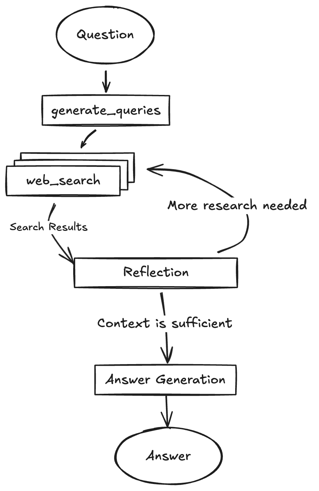
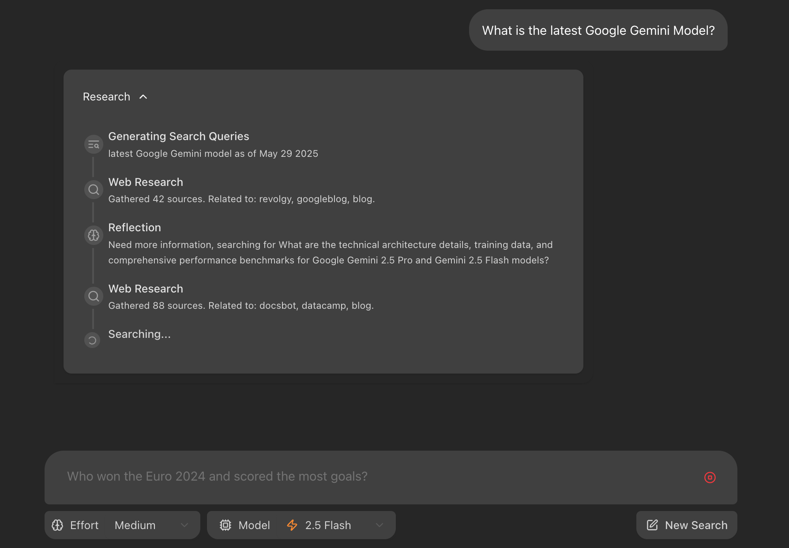

# 深度研究智能体（Deep Research Agent）

> 基于 LangGraph 的全栈 AI 研究智能体：DeepSeek 驱动、Tavily 联网检索，
> 自动完成「生成查询 → 多轮搜索 → 反思补漏 → 带引用作答」的完整研究循环。

项目移植改造自 Google 官方示例
[gemini-fullstack-langgraph-quickstart](https://github.com/google-gemini/gemini-fullstack-langgraph-quickstart)，
将模型层从 Gemini 迁移至 DeepSeek、搜索层从 Google Search 迁移至 Tavily，
并解决了迁移过程中的若干兼容性问题（见「改造点与踩坑记录」）。

## 工作原理

智能体以 LangGraph 状态图为核心，研究流程是一个可循环的图：

1. **生成查询** —— 根据用户问题，批量生成多组初始搜索词
2. **联网检索** —— 调用 Tavily API 逐词搜索，汇总网页摘要与原始链接
3. **反思评估** —— LLM 检查现有证据能否回答问题，找出知识缺口并生成补充搜索词
4. **循环迭代** —— 重复「检索 → 反思」，直到证据充分或达到轮数上限
5. **综合作答** —— 输出带引用标注的最终答案，每个结论可溯源到具体网页

## 技术栈

| 层级 | 技术 |
|---|---|
| 智能体编排 | LangGraph + LangChain |
| 大模型 | DeepSeek（deepseek-chat） |
| 联网搜索 | Tavily Search API |
| 后端服务 | LangGraph Server（流式输出） |
| 前端 | React + Vite + TypeScript + Tailwind CSS |

## 改造点与踩坑记录

相比原模板的主要改动：

- **LLM 迁移**：Gemini → DeepSeek，调整【configuration.py 中的模型接入方式 / 参数】
- **搜索迁移**：Google Search → Tavily，重写【utils.py 中的搜索封装】

踩坑实录
错误 ：OpenAI 400 —— 结构化输出的 API 兼容性
现象：修完错误 5 后第一次真正调到大模型，generate_query 节点报：

OpenAIInvalidRequestError: Error code: 400 - {'error': {'message': 'This response_format type is unavailable...
排查过程：这个报错有两个关键信息。第一，是 400 不是 401——400 是参数错误、401 是认证失败，所以反而证明了 DeepSeek API Key 是有效的，请求已经到达了对方服务器；第二，报错明说了 “This response_format type is unavailable”——问题出在请求里的 response_format 参数。

原因：graph.py 里有 llm.with_structured_output(SearchQueryList)，作用是强制 LLM 按预定义的 Pydantic 模型输出结构化 JSON。新版 langchain-openai 默认用 json_schema 方式实现（在请求里带 response_format: {"type": "json_schema"}，让服务端按 JSON Schema 硬约束输出）。OpenAI 官方支持这种方式，但 DeepSeek 的兼容接口只支持 function calling 和 json_object，不支持 json_schema，所以直接拒绝请求。

解决：给两处结构化输出调用显式指定方式：

# generate_query 里
structured_llm = llm.with_structured_output(SearchQueryList, method="function_calling")

# reflection 里（不改的话跑到这一步还会栽进同一个坑）
result = llm.with_structured_output(Reflection, method="function_calling").invoke(formatted_prompt)
function_calling 的原理：把 Pydantic 模型注册成一个“工具”，让模型以函数参数的形式返回结构化 JSON——DeepSeek 明确支持这个协议，效果等价。

## 本地运行

### 准备

- Python 3.11+ / Node.js 18+
- API Key：[DeepSeek 平台](https://platform.deepseek.com/)、[Tavily](https://app.tavily.com/)

### 1. 配置密钥

复制 `.env.example` 为 `backend/.env`，填入真实 Key。

### 2. 启动后端

